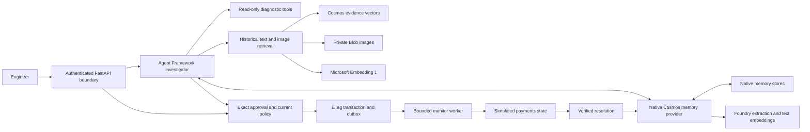

# Architecture

IncidentMemory investigates a fixed simulated payments service. A model can
recommend a correction, but only deterministic application code can authorize
and apply it. Azure management-plane actions are not agent tools.

## Data model and boundaries

| Store | Partition key | Records and responsibility |
| --- | --- | --- |
| Operations | `/scope_id` | Service state, versioned control/policy, incidents, proposals, approvals, outbox, audit, resolutions, and memory receipts/reviews |
| Evidence | `/scope_id` | Historical text/image artifacts, provenance, version/content hash, model metadata, and dense evidence vectors |
| Native memory base, turns, summaries | `[/user_id, /thread_id]` | Toolkit-owned turns, facts, summaries, procedures, and episodes |
| Native counter | `[/user_id, /thread_id]` | Toolkit cadence counters touched by native memory writes |
| Private Blob container | Blob name | Historical synthetic PNG payloads; metadata and evidence IDs remain in Cosmos |

Operational records include `id`, `type`, `scope_id`, and type-specific version
fields. Cosmos supplies `_etag`. A service snapshot contains `pool_size`,
`demand`, `backend_capacity`, `config_valid`, and a monotonic `version`.
Metrics are derived deterministically from that state, not read from a real
payments deployment.

Evidence records retain artifact source/capture metadata, content identity,
embedding model, and dimensions. Cache records are distinct from searchable
evidence records. Unchanged payloads can reuse embeddings without discarding
updated artifact metadata.

Native memory uses the pinned Toolkit's `type` wire field and its own schema.
The server derives the shared native `user_id` from the authorized scope,
service, and environment; a caller cannot choose another service's memory
namespace. Membership checks, not partition identifiers, grant access.

The infrastructure also provisions the toolkit's `counter` container. Native
turns have a 30-day default TTL; base memories and summaries use item-controlled
TTL with no default expiry. Audit, review, and long-term memory retention require
an explicit policy rather than assuming a reset erases them.

### Two different vector spaces

Evidence uses `microsoft-embedding-1-large`: query, text, and image inputs are
embedded into the same dense 1,536-dimensional float32/cosine space.
The application stores vectors alongside evidence and performs scoped
`VectorDistance` retrieval.

The native-memory toolkit uses a separate Foundry text-embedding deployment.
Matching vector lengths do **not** make the two models interchangeable. Never
compare an evidence query vector with native-memory vectors. Changing either
model/configuration requires compatible stores and regeneration of affected
vectors. See [compatibility](compatibility.md).

## Design patterns in the implementation

| Pattern | Source | Why it matters |
| --- | --- | --- |
| Document/schema versioning | [Cosmos repository](../app/cosmos.py), [policy](../app/policy.py) | Validate document shape and reject stale target/policy versions |
| Optimistic concurrency and Patch API | [remediation](../app/remediation.py), [simulation](../app/simulation.py) | Preserve exact preconditions using ETags and bounded patches |
| Transactional outbox | [remediation](../app/remediation.py) | Commit operational transition and intent in one logical partition |
| Idempotent work | [monitoring](../app/monitoring.py) | Retry stable operation IDs without duplicate corrections |
| Multimodal RAG | [evidence](../app/evidence.py), [embeddings](../app/embeddings.py) | Retrieve historical text/images with provenance, not invented evidence |
| Native long-term memory | [memory](../app/memory.py), [agent](../app/agent.py) | Recall verified lessons across fresh agent sessions |
| Fail-closed HTTP boundary | [main](../app/main.py), [security](../app/security.py) | Authorize every scoped action and reject incomplete live setup |

These patterns are illustrated in
[Azure-Samples](https://github.com/Azure-Samples/cosmos-db-design-patterns).
Cosmos transactional batches are atomic only within one container and logical
partition. Native memory and Blob operations are not part of the operational
transaction; durable outbox work handles later processing.

## Actual agent tool calls

[DiagnosticTools](../app/tools.py) registers these read-only functions:

| Tool | Input | Returned evidence |
| --- | --- | --- |
| `health()` | None | Current healthy flag, error rate, and latency |
| `metrics()` | None | Current metrics, demand, pool size, and backend capacity |
| `config()` | None | Current pool size, deployment validity, and version |
| `backend()` | None | Current backend capacity and demand |
| `deployment()` | None | Current configuration validity and restart count |
| `logs(limit=10)` | Integer 1-20 | Persisted incident audit events |
| `history(limit=5)` | Integer 1-20 | Persisted service resolution summaries |
| `evidence(query)` | Query text | Bounded historical vector-search hits and retrieval metadata |

Tool order is chosen by the agent; a verified memory can suggest diagnostic
priority but cannot supply current telemetry. The transcript is not a guarantee
that a particular model will call every tool in a fixed order.

Only registered payments questions are accepted; see the
[prompt contract](demo.md#supported-questions). Before reasoning, the application
retrieves historical evidence and, when
enabled, native memory. It passes bounded excerpts and up to two retrieved
historical images to a Foundry deployment with image input and tool calling.
The model returns structured `summary`, `root_cause`, `proposed_value`, and
`diagnostic_order`; these fields are suggestions, not authority.

The native context-provider subclass is retrieval-only: its `before_run` hook
injects verified references as user-role context and `after_run` does not learn
from unverified analysis. It avoids the upstream entry path that creates stores.
The memory service owns SDK connections and explicit verified-outcome processing.

Only observations from **all four** `health`, `config`, `backend`, and `metrics`
tools can support a pool proposal. They must agree on the current service
version. Execution checks their source, timestamps, exact values, and proposal
binding again. Incomplete, stale, malformed, or contradictory proof cannot
authorize a correction.

## Human and autonomous operation

- **Guarded:** an operator reviews and approves the exact proposal digest.
  Approval binds the service, target/value, state/policy version, expiry, and
  diagnostic proof. Saying "approved" in chat has no effect.
- **Autonomous:** an administrator enables a narrow expiring policy. The current
  policy permits only the configured `pool_adjust` from 50 to 100, with fresh
  valid telemetry, demand at most 100, sufficient backend capacity, and action,
  attempt, concurrency, and cooldown limits. Memory does not create this right.
- **Paused:** new remediation is blocked and earlier version-bound approvals
  become stale. Already committed effects are not undone by a pause.

The walkthrough enables autonomy only after inspecting a verified memory.
That sequence is an operator practice, not an additional memory-count
authorization gate in the policy implementation.

## Monitoring, alerts, and investigation

The single application worker polls every `MONITOR_INTERVAL_SECONDS` (default
10). It processes pending outbox actions and verified-memory work. In autonomous
mode it also detects an unhealthy simulation snapshot and claims a deterministic
incident ID with an expiring lease. It then investigates, rechecks the policy and
target, and queues only an authorized proposal.

Guarded mode still processes already approved actions, but does not initiate
unattended investigations. Autonomous detection does not depend on an open
browser or a prompt to "watch" the service. Deployment errors escalate instead
of triggering pool expansion. Repeated model failures can suspend unattended
work; memory extraction failures remain observable and retry within bounds.

The console and `GET /api/status` expose service metrics, control state,
incidents, proposals, audit history, and worker health. This is the application's
alert/incident visibility; no Azure Monitor action group, email, pager, or
production telemetry collector is implemented. External alerts and a production
audit sink would require separate integration.

Default investigation limits are 12 model calls, 15 diagnostic calls, 120 seconds,
and 4,096 aggregate generated tokens. The last limit is **not** an input-token or
total billing cap. Evidence and memory retrieval each default to five hits.
The status snapshot cache can delay displayed state by up to 10 seconds.

## What learning means

A successful write is not a verified resolution. The worker reads health after
the bounded simulation correction, persists the outcome, and enqueues native
memory processing only for verified recovery. Native turns are processed with
`process_now`, including summary, extraction, reconciliation, procedural, and
user-summary processing. Missing completion/readback remains retryable work,
not a learned result.

The adapter also persists a typed, deterministic verified episode and an active
read-only diagnostic procedure tied to that independently verified resolution.
It uses the native typed store, not generic procedural insertion, and the same
native text-embedding client as processing/recall. Extracted records and verified
references must pass scoped content/vector readback before completion.

Native receipts bind the outcome and content hashes to the configured embedding
deployment. `flush()`, `embed=True`, or a model saying it learned are not enough.
Vector repair preserves native ID/provenance through typed re-embedding and
readback. Candidate or retired procedures do not become trusted references.
Memory review/invalidation is authenticated; durable tombstones prevent an
invalidated record from silently becoming trusted again.

Learning here means recalling verified outcomes and diagnostic lessons. It does
not retrain model weights, improve permissions, bypass current checks, or guarantee
lower token use. A fresh-session investigation must still verify current conditions.
